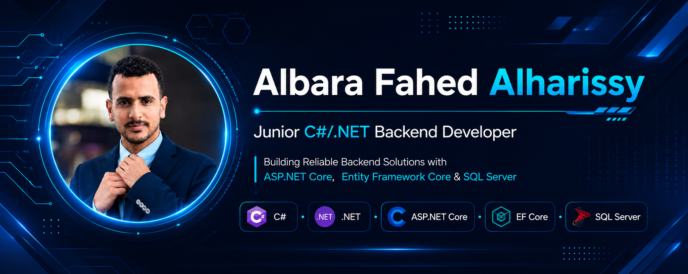

  

<h1 align="center">Hi there 👋 I'm Albara Fahed Alharissy</h1>

<h3 align="center">
Junior C# / .NET Backend Developer
</h3>

Building backend applications and RESTful APIs using
<strong>C#</strong>, <strong>ASP.NET Core</strong>,
<strong>Entity Framework Core</strong>, and <strong>SQL Server</strong>.

  
  
  

---

# 🚀 About Me

I'm **Albara Fahed Alharissy**, an Information Technology student at **Al-Jazeera University** and a Junior **C# / .NET Backend Developer**.

I focus on building maintainable backend applications, designing RESTful APIs, working with relational databases, and implementing business logic.

My development experience includes:

- Building desktop applications using **C# WinForms** and **ADO.NET**.
- Developing RESTful APIs using **ASP.NET Core Web API**.
- Working with **SQL Server**, **Entity Framework Core**, and database design.
- Applying **Clean Architecture**, **Layered Architecture**, and **3-Tier Architecture**.
- Implementing authentication, authorization, and API security features.
- Writing unit and integration tests using **xUnit** and **Moq**.

I'm continuously improving my backend development and software engineering skills through practical projects.

---

# 💻 Tech Stack

### Backend Development

  

- C#
- .NET 8
- ASP.NET Core Web API
- Entity Framework Core
- ADO.NET
- LINQ
- RESTful APIs
- JWT Authentication
- Role-Based Authorization

### Databases

  

- Microsoft SQL Server
- T-SQL
- Database Design
- Entity Relationships
- Stored Procedures
- SQLite

### Software Engineering

- Object-Oriented Programming (OOP)
- SOLID Principles
- Clean Architecture
- Layered Architecture
- 3-Tier Architecture
- Repository Pattern
- Dependency Injection
- DTOs
- Separation of Concerns
- Design Patterns

### Testing & Tools

  

- Unit Testing
- Integration Testing
- xUnit
- Moq
- Git & GitHub
- Visual Studio
- SQL Server Management Studio

---

# 📂 Featured Projects

## 🔐 Student Management API

A secure Student Management RESTful API built with **C#**, **ASP.NET Core Web API**, **.NET 8**, **SQL Server**, and **ADO.NET**, following a layered architecture.

**Key Features:**
- Student management operations.
- JWT Authentication.
- Access and Refresh Tokens.
- Role-Based and Ownership-Based Authorization.
- Login Rate Limiting.
- BCrypt Password Hashing.
- Asynchronous database operations.
- Unit and Integration Testing using xUnit and Moq.

**Technologies:** C#, ASP.NET Core Web API, SQL Server, ADO.NET, JWT, xUnit, Moq.

🔗 **Repository:**  
https://github.com/Albarafahed/StudentsApiThreeTierArchitecture

---

## 📇 Contacts Management API

A Contact Management RESTful API developed using **C#**, **ASP.NET Core Web API**, **.NET 8**, **Entity Framework Core**, and **SQL Server**, following Clean Architecture principles.

**Key Features:**
- Contact CRUD operations.
- Clean Architecture.
- Repository Pattern.
- Dependency Injection.
- DTOs and Application Services.
- Asynchronous Data Access.
- JWT Authentication.
- Role-Based Authorization.
- Centralized Exception Handling.
- Logging and Auditing.

**Technologies:** C#, .NET 8, ASP.NET Core Web API, EF Core, SQL Server, LINQ.

🔗 **Repository:**  
https://github.com/Albarafahed/ContactsSystemCleanArchitecture

---

## 🚗 Drivers & Vehicle Licensing Department (DVLD)

A desktop management system developed using **C# WinForms**, **SQL Server**, and **ADO.NET**, following 3-Tier Architecture.

**Key Features:**
- Driver Management.
- License Management.
- Local and International Licenses.
- Testing and Appointment Workflows.
- User Management.
- Application Management.

**Technologies:** C#, WinForms, SQL Server, ADO.NET, 3-Tier Architecture.

🔗 **Repository:**  
https://github.com/Albarafahed/DVLD-Windows-Form-CSharp

---

## 🏥 Clinic Management System

A desktop application for managing clinic operations and organizing its main workflows.

**Key Features:**
- Patient Management.
- Doctor Management.
- Appointments.
- Visits.
- Pharmacy.
- Cashier.
- Medical Services.

**Technologies:** C#, SQL Server, ADO.NET, 3-Tier Architecture.

🔗 **Repository:**  
https://github.com/Albarafahed/Clinic-Windows-Form-CSharp

---

## 🏠 Real Estate Management System

A property management application built using C# and SQL Server.

**Technologies:**
- C#
- WinForms
- SQL Server
- ADO.NET
- N-Tier Architecture

🔗 **Repository:**  
https://github.com/Albarafahed/RealEstateSolution-Windows-Form-CSharp

---

## 📇 Contacts Management Desktop Application

A desktop CRUD application demonstrating contact management and database operations.

**Technologies:**
- C#
- WinForms
- SQL Server
- ADO.NET
- Layered Architecture

🔗 **Repository:**  
https://github.com/Albarafahed/Contact-Windows-Form-CSharp

---

## 🍕 Pizza Ordering Management System

A desktop ordering application built using C# and WinForms.

**Technologies:**
- C#
- WinForms
- JSON Persistence
- Layered Architecture

🔗 **Repository:**  
https://github.com/Albarafahed/Pizza-Ordering-Management-System--Windows-Form-CSharp

---

# 📖 Currently Learning & Improving

- ASP.NET Core Backend Development
- API Security and Authorization
- Automated Testing
- Docker
- Azure and Secrets Management
- Software Architecture and Design Patterns

---

# 📊 GitHub Statistics

  
  

---

# 📈 GitHub Activity

  

---

# 🌐 Portfolio

  

---

# 🤝 Let's Connect

  
  
  

  <i>"Building reliable backend solutions, one project at a time."</i>

